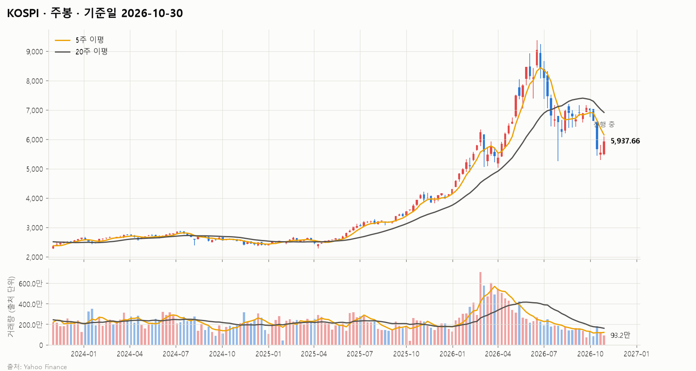
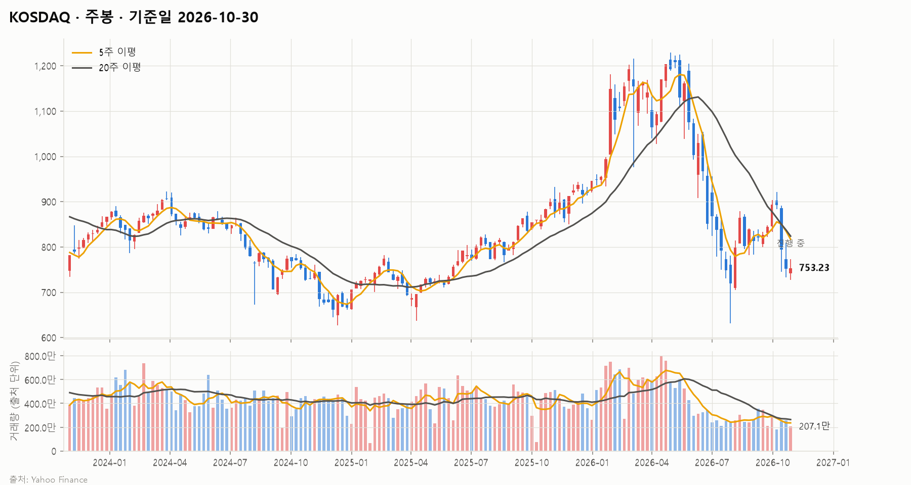
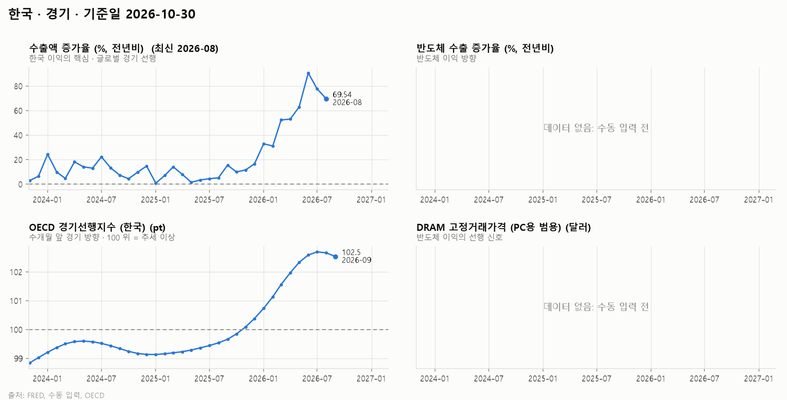
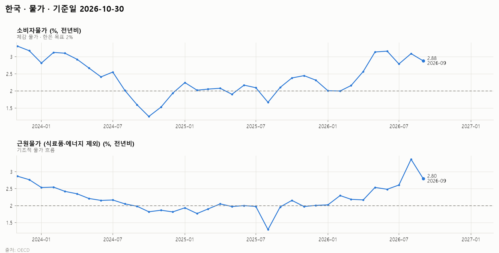
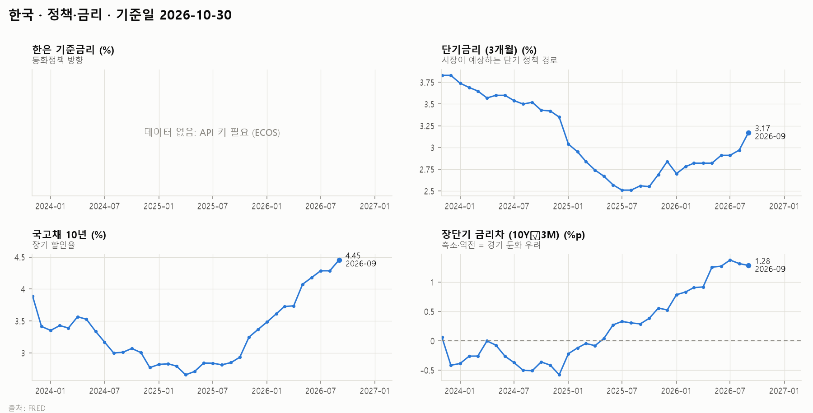
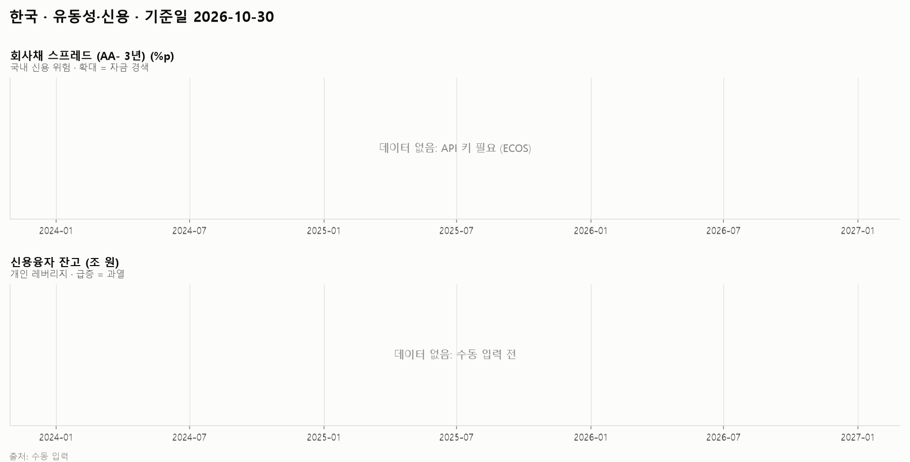
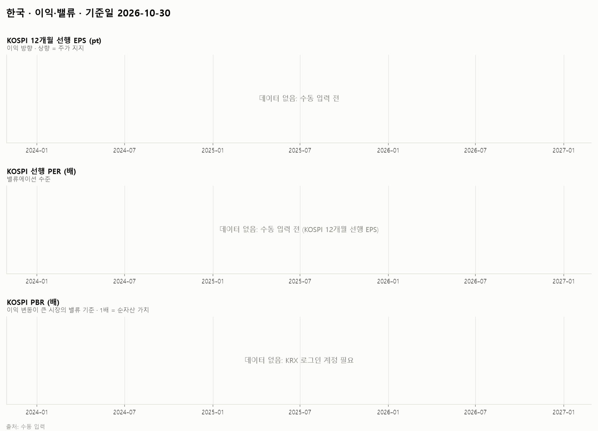
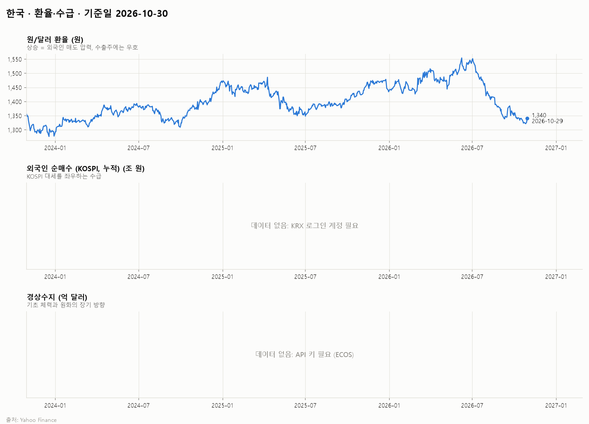

# 한국 시장 보고서 · 2026-10-30

## 1. 시장 요약

<!-- summary:start -->
> KOSPI는 SK하이닉스 실적 발표로 한 주간 7.3% 반등해 5,937.66(10/29)에 마쳤지만, 10월 중순 외국인 대량 매도로 1개월 −13.6%, 52주 고점 대비 −36.7%에 머물러 있다.
<!-- summary:end -->

### 지수 현황

기준: 발행 시점(2026-10-30 12:10 KST)에 확정된 각 지수의 직전 종가

| 지수 | 종가 | 종가일 | 1주 | 1개월 | 3개월 | 연초 대비 | 1년 | 52주 고점 대비 |
|---|---|---|---|---|---|---|---|---|
| KOSPI | 5,937.66 | 2026-10-29 | +7.3% | -13.6% | +4.8% | +40.9% | +45.5% | -36.7% |
| KOSDAQ | 753.23 | 2026-10-29 | -1.4% | -11.4% | +13.7% | -18.6% | -16.5% | -38.7% |

### 주요 요인

<!-- factors:start -->
1. **[환율·수급] 10월 중순 외국인 대량 매도** — 10월 13일 코스피는 5.46% 내린 6,035.35에 마감했고 외국인은 4조5,128억 원을 순매도했다. SK하이닉스(−10.09%)와 삼성전자(−7.39%)가 급락했으며, 기사는 메모리 경쟁 심화 우려와 삼성전자 자사주 매입 종료를 원인으로 꼽았다 ([서울신문](https://www.seoul.co.kr/news/economy/securities/2026/10/13/20261013500225)). 해석: 반도체 이익 정점 논란 속에서 외국인 매도가 지수 하락을 주도했다.
2. **[이익·밸류] SK하이닉스 3분기 실적과 주주환원** — SK하이닉스는 3분기 영업이익 83조3,338억 원을 발표하고 약 100조 원 규모의 주주환원 계획을 밝혔다. 10월 28일 코스피는 6.63% 오른 6,012.44로 10거래일 만에 6,000선을 되찾았고 외국인은 8,228억 원을 순매수했다 ([파이낸셜뉴스](https://www.fnnews.com/news/202610290701410620)). 해석: 실적이 '메모리 이익 정점론'을 일부 반박하면서 외국인 매도가 멈췄다.
3. **[기타] 발행 시점 장중 급락** — 10월 30일 오전 10시 4분 코스피 시장에 매도 사이드카가 발동됐고, 10시 13분 기준 코스피는 5.01% 내린 5,639.95였다. 전날 알파벳이 잉여현금흐름 악화로 12.6% 떨어지는 등 미국 기술주가 급락한 영향이며, 삼성전자는 3분기 영업이익 107조4,405억 원 발표에도 주주환원 실망으로 전날 4.13% 내렸다 ([뉴스핌](https://www.newspim.com/news/view/20261030000389)). 해석: 미국 AI 투자 수익성 우려가 반도체 비중이 큰 한국 증시에 가장 크게 전이되고 있다. 이 하락은 지수 현황 표(10/29 종가)에 반영되지 않았다.
4. **[경기] 수출 호조와 원화 강세** — OECD 집계 한국 수출액(원화 기준)은 8월 전년비 +69.5%였고, 원/달러 환율은 1,340원(10/29)으로 3개월 전 1,453원보다 크게 낮아졌다 (FRED·Yahoo Finance, 2.1·2.6절). 해석: 수출이 이익 기반을 받치고 원화 강세는 외국인 환차익 측면에서 우호적이지만, 이번 달 주가는 이런 기초 여건보다 AI 업황 기대 변화에 더 크게 흔들렸다.
<!-- factors:end -->

## 2. 지표 (최근 3년)

### 2.1 경기

| 지표 | 최신값 | 기준 시점 | 3개월 전 | 1년 전 |
|---|---|---|---|---|
| 수출액 증가율 (%, 전년비) | 69.54 | 2026-08 | 62.85 | 5.16 |
| 반도체 수출 증가율 (%, 전년비) | — | — | — | — |
| OECD 경기선행지수 (한국) (pt) | 102.5 | 2026-09 | 102.6 | 99.66 |
| DRAM 고정거래가격 (PC용 범용) (달러) | — | — | — | — |

데이터 메모:

- 수출액 증가율: 최신 데이터가 2026-08로 지연
- 반도체 수출 증가율: 데이터 없음 (수동 입력 전)
- DRAM 고정거래가격 (PC용 범용): 데이터 없음 (수동 입력 전)

### 2.2 물가

| 지표 | 최신값 | 기준 시점 | 3개월 전 | 1년 전 |
|---|---|---|---|---|
| 소비자물가 (%, 전년비) | 2.88 | 2026-09 | 3.16 | 2.10 |
| 근원물가 (식료품·에너지 제외) (%, 전년비) | 2.80 | 2026-09 | 2.48 | 1.96 |

### 2.3 정책·금리

| 지표 | 최신값 | 기준 시점 | 3개월 전 | 1년 전 |
|---|---|---|---|---|
| 한은 기준금리 (%) | — | — | — | — |
| 단기금리 (3개월) (%) | 3.17 | 2026-09 | 2.91 | 2.56 |
| 국고채 10년 (%) | 4.45 | 2026-09 | 4.18 | 2.85 |
| 장단기 금리차 (10Y−3M) (%p) | 1.28 | 2026-09 | 1.27 | 0.29 |

데이터 메모:

- 한은 기준금리: 데이터 없음 (API 키 필요 (ECOS))

### 2.4 유동성·신용

| 지표 | 최신값 | 기준 시점 | 3개월 전 | 1년 전 |
|---|---|---|---|---|
| 회사채 스프레드 (AA- 3년) (%p) | — | — | — | — |
| 신용융자 잔고 (조 원) | — | — | — | — |

데이터 메모:

- 회사채 스프레드 (AA- 3년): 데이터 없음 (API 키 필요 (ECOS))
- 신용융자 잔고: 데이터 없음 (수동 입력 전)

### 2.5 이익·밸류

| 지표 | 최신값 | 기준 시점 | 3개월 전 | 1년 전 |
|---|---|---|---|---|
| KOSPI 12개월 선행 EPS (pt) | — | — | — | — |
| KOSPI 선행 PER (배) | — | — | — | — |
| KOSPI PBR (배) | — | — | — | — |

데이터 메모:

- KOSPI 12개월 선행 EPS: 데이터 없음 (수동 입력 전)
- KOSPI 선행 PER: 데이터 없음 (수동 입력 전 (KOSPI 12개월 선행 EPS))
- KOSPI PBR: 데이터 없음 (KRX 로그인 계정 필요)

### 2.6 환율·수급

| 지표 | 최신값 | 기준 시점 | 3개월 전 | 1년 전 |
|---|---|---|---|---|
| 원/달러 환율 (원) | 1,340 | 2026-10-29 | 1,453 | 1,426 |
| 외국인 순매수 (KOSPI, 누적) (조 원) | — | — | — | — |
| 경상수지 (억 달러) | — | — | — | — |

데이터 메모:

- 외국인 순매수 (KOSPI, 누적): 데이터 없음 (KRX 로그인 계정 필요)
- 경상수지: 데이터 없음 (API 키 필요 (ECOS))
