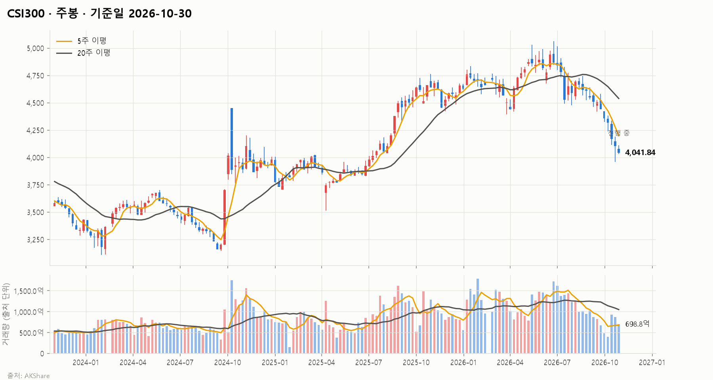
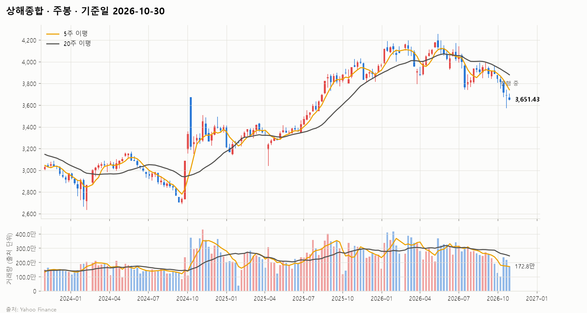
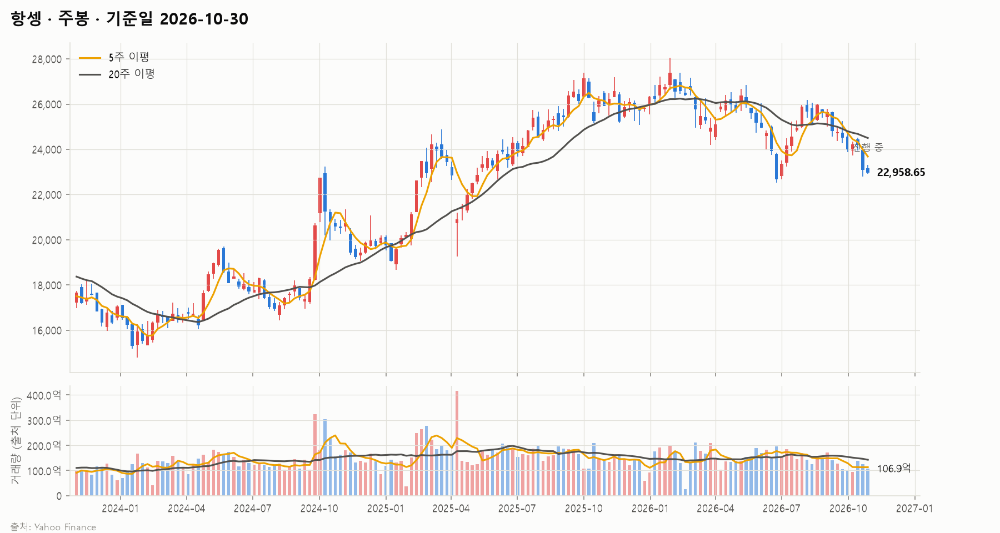
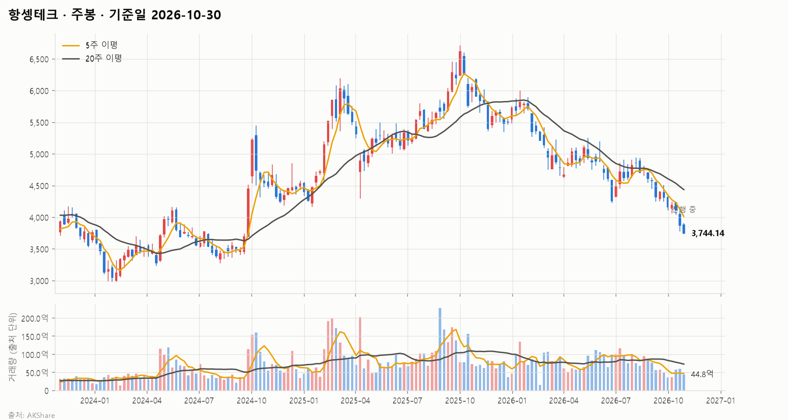
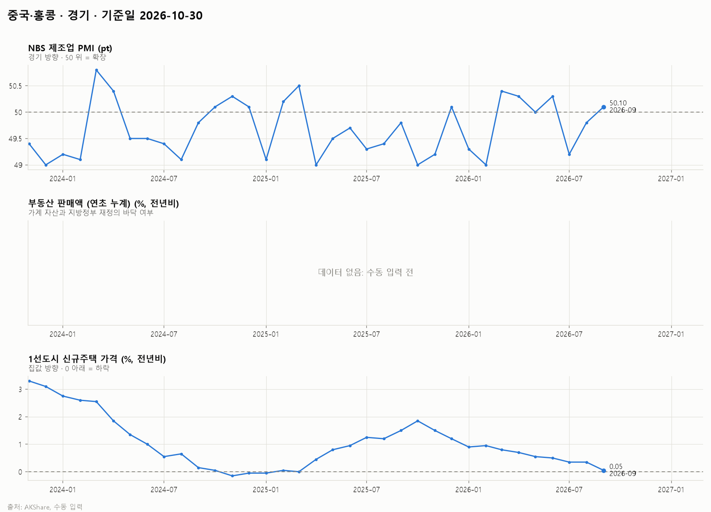
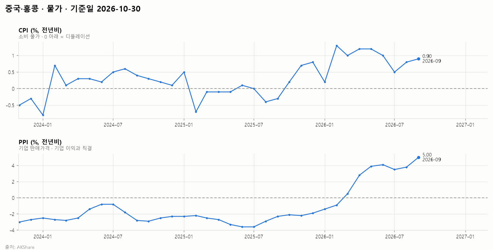
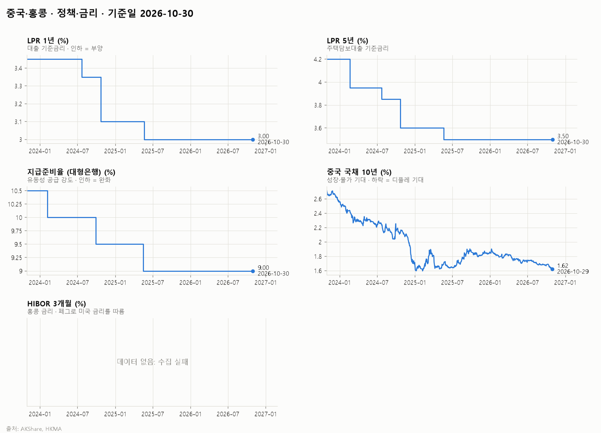
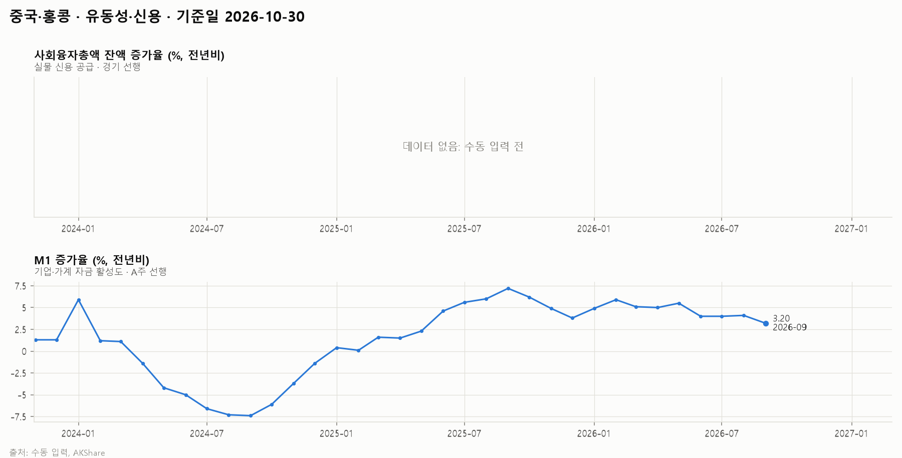
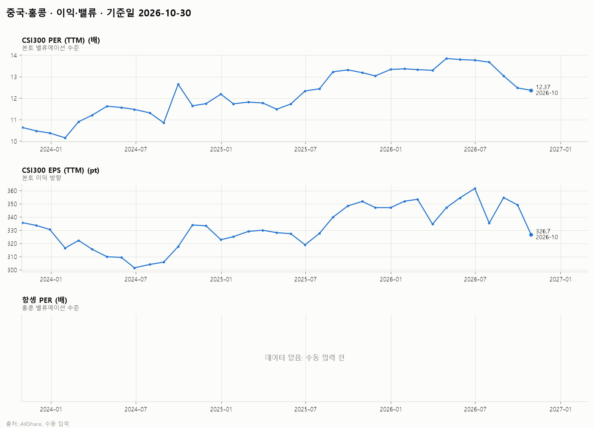
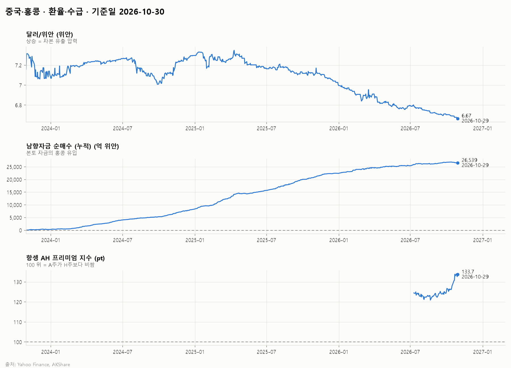

# 중국·홍콩 시장 보고서 · 2026-10-30

## 1. 시장 요약

<!-- summary:start -->
> CSI300은 4,041.84(10/29)로 6월 고점 대비 약 20% 떨어져 약세장에 들어섰고, 이익 감소와 부양 기대 후퇴가 하락을 이끌고 있다.
<!-- summary:end -->

### 지수 현황

기준: 발행 시점(2026-10-30 12:10 KST)에 확정된 각 지수의 직전 종가

| 지수 | 종가 | 종가일 | 1주 | 1개월 | 3개월 | 연초 대비 | 1년 | 52주 고점 대비 |
|---|---|---|---|---|---|---|---|---|
| CSI300 | 4,041.84 | 2026-10-29 | +0.1% | -7.0% | -12.1% | -12.7% | -14.9% | -20.2% |
| 상해종합 | 3,651.43 | 2026-10-29 | -0.2% | -4.7% | -4.6% | -8.0% | -9.1% | -14.3% |
| 항셍 | 22,958.65 | 2026-10-29 | +0.1% | -6.4% | -11.0% | -10.4% | -12.9% | -18.2% |
| 항셍테크 | 3,744.14 | 2026-10-29 | -1.3% | -11.9% | -23.0% | -32.1% | -38.6% | -37.9% |

### 주요 요인

<!-- factors:start -->
1. **[이익·밸류] 이익 감소 속 기록적 연속 하락** — CSI300은 10월 22일 4,036.30에 마감해 6월 고점 대비 약 20% 하락하며 약세장에 진입했고, 주간 기준 10주 연속 하락으로 사상 최장 기록을 세웠다 ([Khan Capital](https://khancapitals.com/csi-300-bear-market/)). CSI300의 최근 12개월 EPS는 326.7로 3개월 전 361.6보다 약 10% 줄었다 (AKShare, 2.5절). 해석: 상반기 AI 랠리가 되돌려지는 가운데 이익까지 줄어 밸류에이션 하락과 이익 감소가 겹쳤다.
2. **[경기] 성장률 호조가 오히려 부양 기대를 낮춤** — 3분기 GDP는 전년비 4.5%로 예상(4.4%)을 웃돌았지만 9월 소매판매는 1.1% 증가에 그쳤다 ([Khan Capital](https://khancapitals.com/csi-300-bear-market/)). 9월 PPI는 전년비 +5.0%로 1년 전 −2.3%에서 크게 올랐다 (AKShare, 2.2절). 해석: 성장률 목표 달성과 생산자물가 상승으로 대규모 부양이나 공격적 완화 기대가 줄었고, 가계 수요는 여전히 약하다.
3. **[기타] 희토류 수출통제 유예 종료 임박** — 2025년 11월 7일 발표된 희토류 수출통제 확대 조치의 1년 유예가 2026년 11월 10일 끝나며, 연장 소식은 없다 ([Pomegra](https://pomegra.io/briefs/2026-10-26-csi-300-11th-weekly-decline)). 해석: 미중 갈등 재점화 가능성이 위험 회피를 키우는 요인이다.
4. **[환율·수급] 홍콩 기술주 낙폭 확대** — 항셍테크는 최근 1개월 −11.9%, 3개월 −23.0%로 항셍(−6.4%, −11.0%)보다 크게 떨어졌다. AH 프리미엄 지수는 133.7로 3개월 전 122.5에서 올라 H주가 A주보다 더 약했다 (AKShare, 지수 현황 표·2.6절). 해석: AI·기술주 조정이 해외 자금 비중이 큰 홍콩에 더 크게 반영되고 있다.
<!-- factors:end -->

## 2. 지표 (최근 3년)

### 2.1 경기

| 지표 | 최신값 | 기준 시점 | 3개월 전 | 1년 전 |
|---|---|---|---|---|
| NBS 제조업 PMI (pt) | 50.10 | 2026-09 | 50.30 | 49.80 |
| 부동산 판매액 (연초 누계) (%, 전년비) | — | — | — | — |
| 1선도시 신규주택 가격 (%, 전년비) | 0.05 | 2026-09 | 0.50 | 1.50 |

데이터 메모:

- 부동산 판매액 (연초 누계): 데이터 없음 (수동 입력 전)

### 2.2 물가

| 지표 | 최신값 | 기준 시점 | 3개월 전 | 1년 전 |
|---|---|---|---|---|
| CPI (%, 전년비) | 0.90 | 2026-09 | 1.00 | -0.30 |
| PPI (%, 전년비) | 5.00 | 2026-09 | 4.10 | -2.30 |

### 2.3 정책·금리

| 지표 | 최신값 | 기준 시점 | 3개월 전 | 1년 전 |
|---|---|---|---|---|
| LPR 1년 (%) | 3.00 | 2026-10-30 | 3.00 | 3.00 |
| LPR 5년 (%) | 3.50 | 2026-10-30 | 3.50 | 3.50 |
| 지급준비율 (대형은행) (%) | 9.00 | 2026-10-30 | 9.00 | 9.00 |
| 중국 국채 10년 (%) | 1.62 | 2026-10-29 | 1.73 | 1.82 |
| HIBOR 3개월 (%) | — | — | — | — |

데이터 메모:

- HIBOR 3개월: 데이터 없음 (수집 실패)

### 2.4 유동성·신용

| 지표 | 최신값 | 기준 시점 | 3개월 전 | 1년 전 |
|---|---|---|---|---|
| 사회융자총액 잔액 증가율 (%, 전년비) | — | — | — | — |
| M1 증가율 (%, 전년비) | 3.20 | 2026-09 | 4.00 | 7.20 |

데이터 메모:

- 사회융자총액 잔액 증가율: 데이터 없음 (수동 입력 전)

### 2.5 이익·밸류

| 지표 | 최신값 | 기준 시점 | 3개월 전 | 1년 전 |
|---|---|---|---|---|
| CSI300 PER (TTM) (배) | 12.37 | 2026-10 | 13.77 | 13.32 |
| CSI300 EPS (TTM) (pt) | 326.7 | 2026-10 | 361.6 | 348.4 |
| 항셍 PER (배) | — | — | — | — |

데이터 메모:

- 항셍 PER: 데이터 없음 (수동 입력 전)

### 2.6 환율·수급

| 지표 | 최신값 | 기준 시점 | 3개월 전 | 1년 전 |
|---|---|---|---|---|
| 달러/위안 (위안) | 6.67 | 2026-10-29 | 6.77 | 7.10 |
| 남향자금 순매수 (누적) (억 위안) | 26,539 | 2026-10-29 | 26,162 | 20,761 |
| 항셍 AH 프리미엄 지수 (pt) | 133.7 | 2026-10-29 | 122.5 | — |
