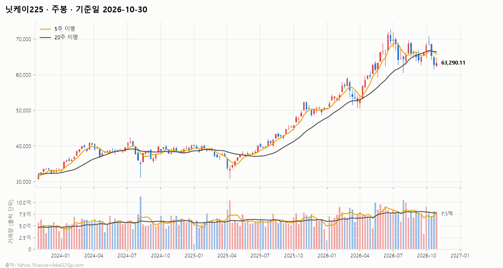
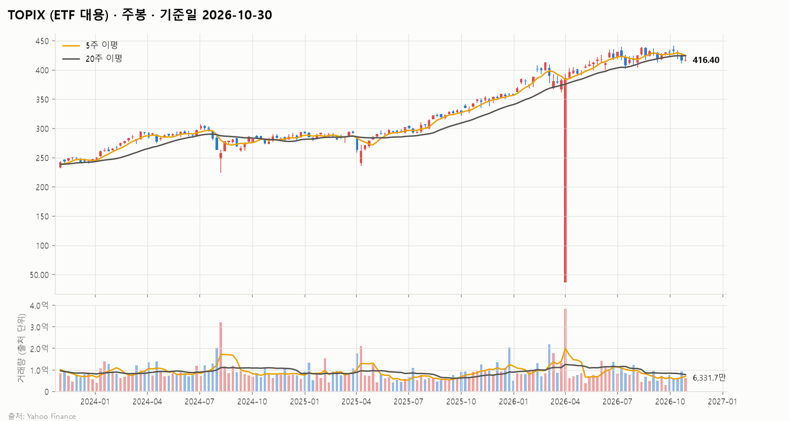
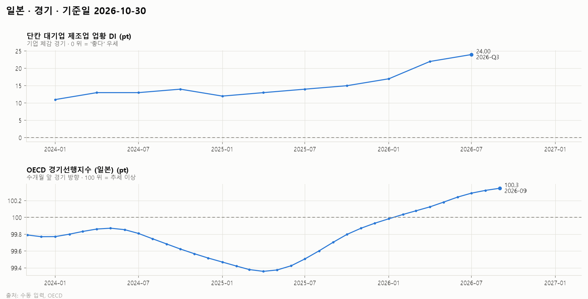
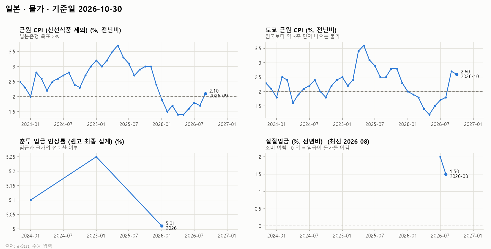
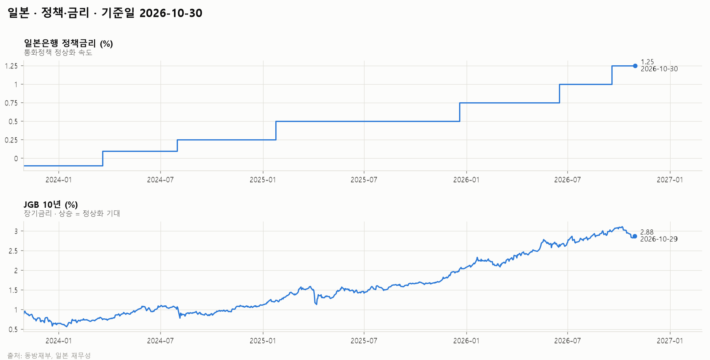
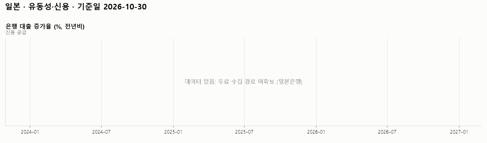
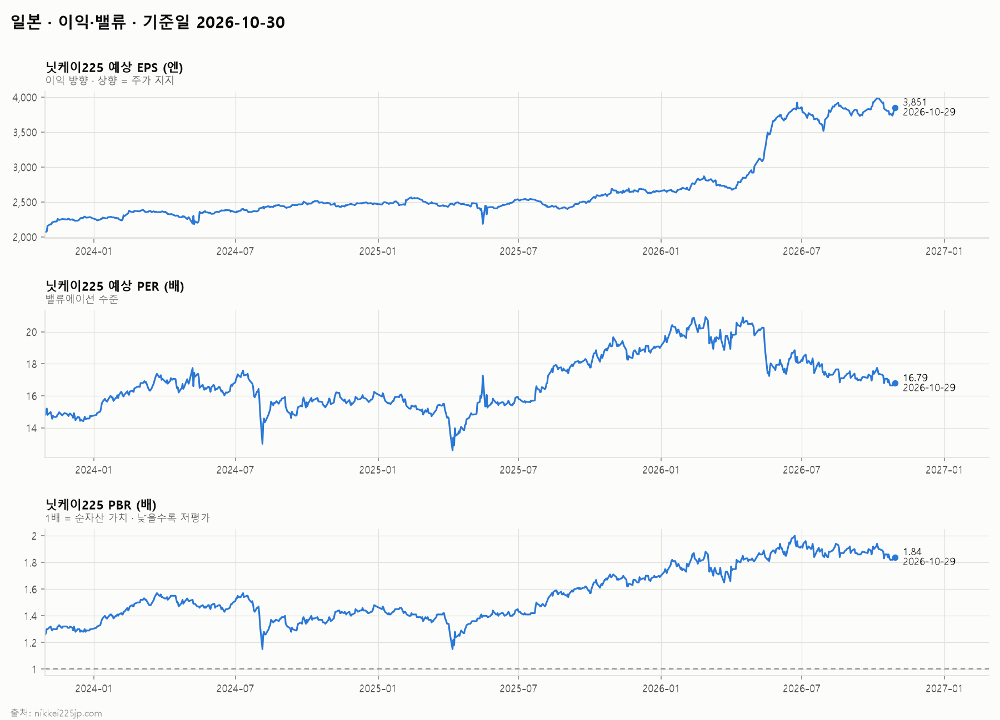
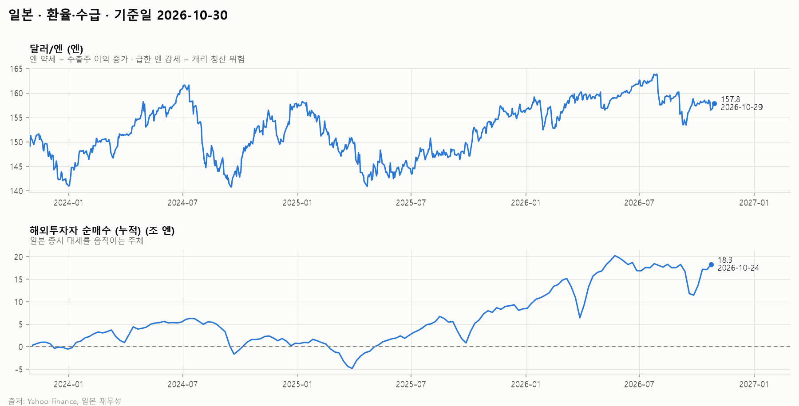

# 일본 시장 보고서 · 2026-10-30

## 1. 시장 요약

<!-- summary:start -->
> 닛케이225는 AI 반도체주 반등으로 64,659.47(10/29)에 마쳤지만 52주 고점 대비 −11.2%이고, 발행 시점에는 일본은행 결정을 앞두고 장중 2% 넘게 밀렸다.
<!-- summary:end -->

### 지수 현황

기준: 발행 시점(2026-10-30 12:10 KST)에 확정된 각 지수의 직전 종가

| 지수 | 종가 | 종가일 | 1주 | 1개월 | 3개월 | 연초 대비 | 1년 | 52주 고점 대비 |
|---|---|---|---|---|---|---|---|---|
| 닛케이225 | 64,659.47 | 2026-10-29 | +2.8% | -1.3% | +5.2% | +28.4% | +26.0% | -11.2% |
| TOPIX (ETF 대용) | 421.30 | 2026-10-29 | +0.2% | -1.0% | +1.5% | +17.7% | +22.5% | -4.7% |

### 주요 요인

<!-- factors:start -->
1. **[정책·금리] 일본은행 추가 인상 경계** — 일본은행은 9월 정책금리를 1995년 4월 이후 최고인 1.25%로 올렸다. 10월 30일 회의는 동결이 예상되지만 인플레이션을 강조해 이르면 12월 인상을 시사할 수 있다는 관측이 나왔다 ([10bmnews](https://10bmnews.com/asian-markets-today-nikkei-tumbles-2-ahead-of-bank-of-japan-rate-decision-kospi-crashes-4/)). JGB 10년물 금리는 2.88%(10/29)로 1년 전 1.66%보다 1.2%p 높다 (일본 재무성, 2.3절). 해석: 금리 정상화가 밸류에이션과 엔화 강세 양쪽에서 주가에 부담이다. 결정 결과는 발행 시점에 아직 나오지 않았다.
2. **[이익·밸류] AI 반도체주 쏠림과 변동성** — 10월 30일 장중 알파벳 실적 부진 여파로 어드밴테스트(−5.43%), 소프트뱅크그룹(−4.66%), 도쿄일렉트론(−3.93%)이 급락하며 닛케이가 2% 넘게 떨어진 반면, TOPIX 하락폭은 0.65%였다 ([10bmnews](https://10bmnews.com/asian-markets-today-nikkei-tumbles-2-ahead-of-bank-of-japan-rate-decision-kospi-crashes-4/)). 해석: 닛케이는 소수 AI·반도체 대형주의 영향이 커서 미국 빅테크 실적에 TOPIX보다 훨씬 민감하다.
3. **[환율·수급] 엔화 강세 전환** — 달러/엔은 157.8엔(10/29)으로 3개월 전 163.9엔보다 엔화가 약 4% 강해졌다 (Yahoo Finance, 2.6절). 해석: 수출기업의 엔화 환산 이익에 불리하고, 일본은행 인상이 이어지면 엔 강세 압력이 더 커질 수 있다.
<!-- factors:end -->

## 2. 지표 (최근 3년)

### 2.1 경기

| 지표 | 최신값 | 기준 시점 | 3개월 전 | 1년 전 |
|---|---|---|---|---|
| 단칸 대기업 제조업 업황 DI (pt) | 24.00 | 2026-Q3 | 22.00 | 14.00 |
| OECD 경기선행지수 (일본) (pt) | 100.3 | 2026-09 | 100.2 | 99.71 |

데이터 메모:

- 단칸 대기업 제조업 업황 DI: 수동 입력 값 11개뿐 (2024-Q1부터)

### 2.2 물가

| 지표 | 최신값 | 기준 시점 | 3개월 전 | 1년 전 |
|---|---|---|---|---|
| 근원 CPI (신선식품 제외) (%, 전년비) | 2.10 | 2026-09 | 1.60 | 2.90 |
| 도쿄 근원 CPI (%, 전년비) | 2.60 | 2026-10 | 1.70 | 2.80 |
| 춘투 임금 인상률 (렌고 최종 집계) (%) | 5.01 | 2026 | 5.25 | 5.25 |
| 실질임금 (%, 전년비) | 1.50 | 2026-08 | — | — |

데이터 메모:

- 춘투 임금 인상률 (렌고 최종 집계): 수동 입력 값 3개뿐 (2024부터)
- 실질임금: 수동 입력 값 2개뿐 (2026-07부터)
- 실질임금: 최신 데이터가 2026-08로 지연

### 2.3 정책·금리

| 지표 | 최신값 | 기준 시점 | 3개월 전 | 1년 전 |
|---|---|---|---|---|
| 일본은행 정책금리 (%) | 1.25 | 2026-10-30 | 1.00 | 0.50 |
| JGB 10년 (%) | 2.88 | 2026-10-29 | 2.76 | 1.66 |

### 2.4 유동성·신용

| 지표 | 최신값 | 기준 시점 | 3개월 전 | 1년 전 |
|---|---|---|---|---|
| 은행 대출 증가율 (%, 전년비) | — | — | — | — |

데이터 메모:

- 은행 대출 증가율: 데이터 없음 (무료 수집 경로 미확보 (일본은행))

### 2.5 이익·밸류

| 지표 | 최신값 | 기준 시점 | 3개월 전 | 1년 전 |
|---|---|---|---|---|
| 닛케이225 예상 EPS (엔) | 3,851 | 2026-10-29 | 3,517 | 2,688 |
| 닛케이225 예상 PER (배) | 16.79 | 2026-10-29 | 17.47 | 19.09 |
| 닛케이225 PBR (배) | 1.84 | 2026-10-29 | 1.85 | 1.69 |

### 2.6 환율·수급

| 지표 | 최신값 | 기준 시점 | 3개월 전 | 1년 전 |
|---|---|---|---|---|
| 달러/엔 (엔) | 157.8 | 2026-10-29 | 163.9 | 151.7 |
| 해외투자자 순매수 (누적) (조 엔) | 18.3 | 2026-10-24 | 17.5 | 5.9 |

## 정정

- 2026-10-30 (발행 후): 일본 e-Stat을 연결해 근원 CPI(신선식품 제외)와 도쿄 근원 CPI를 채웠다. 발행 시점(asof 2026-10-30 12:10 KST)과 지수 수치는 그대로다. 실질임금은 e-Stat API에 최신 시계열이 없어 수동 입력 대상으로 바꿨다.
- 2026-10-30 (발행 후): 수동 입력 대상이던 지표를 보완했다. 발행 시점(asof 2026-10-30 12:10 KST)과 지수 수치는 그대로다.
  - 자동 수집으로 전환: 일본은행 정책금리(동방재부 경유), 해외투자자 순매수(재무성 주간 대내 증권투자로 출처 변경), 닛케이225 예상 PER(nikkei225jp.com 경유, 닛케이 공표 가중평균)
  - 대체: TOPIX PBR → 닛케이225 PBR. TOPIX PBR은 무료 이력이 없음
  - 수동 입력: 단칸 대기업 제조업 DI(2024년 3월~2026년 9월 조사), 춘투 임금 인상률(2024~2026년), 실질임금(2026년 7~8월)
