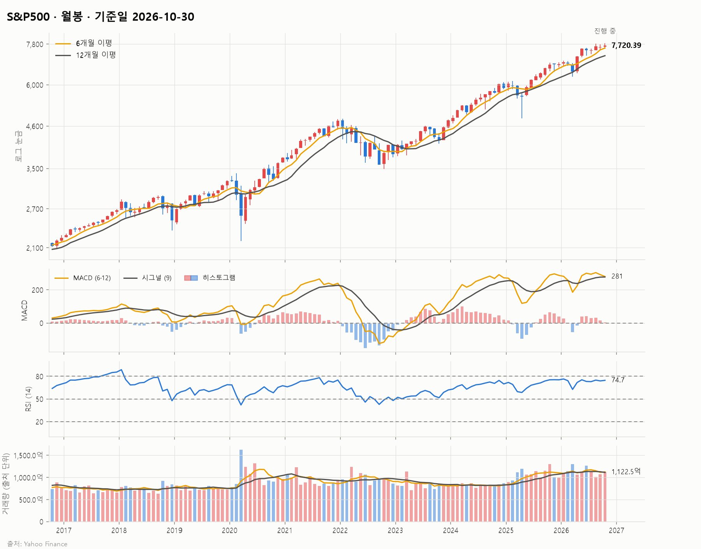
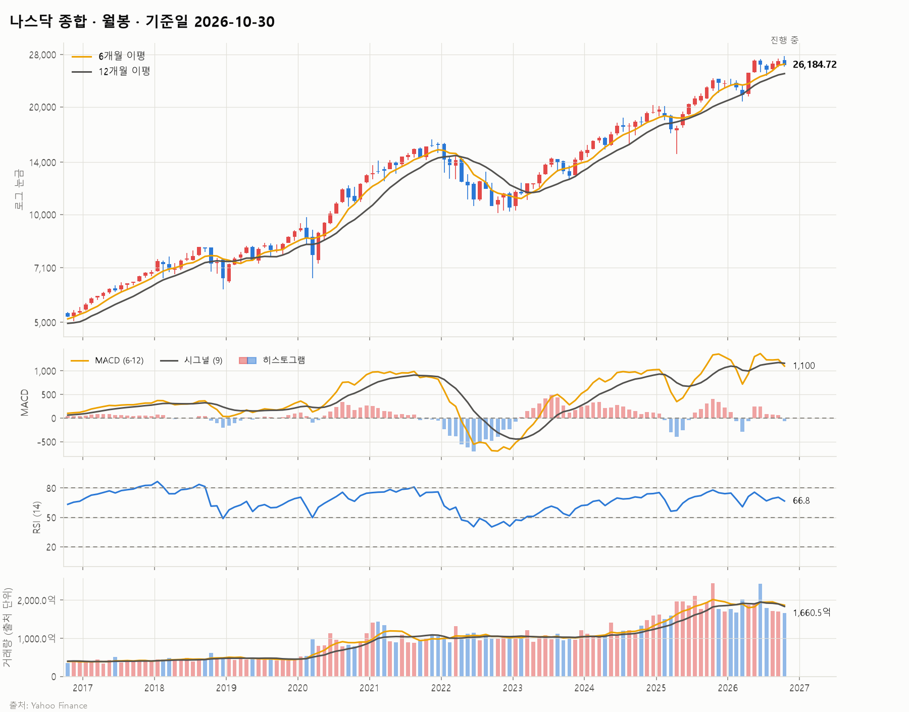
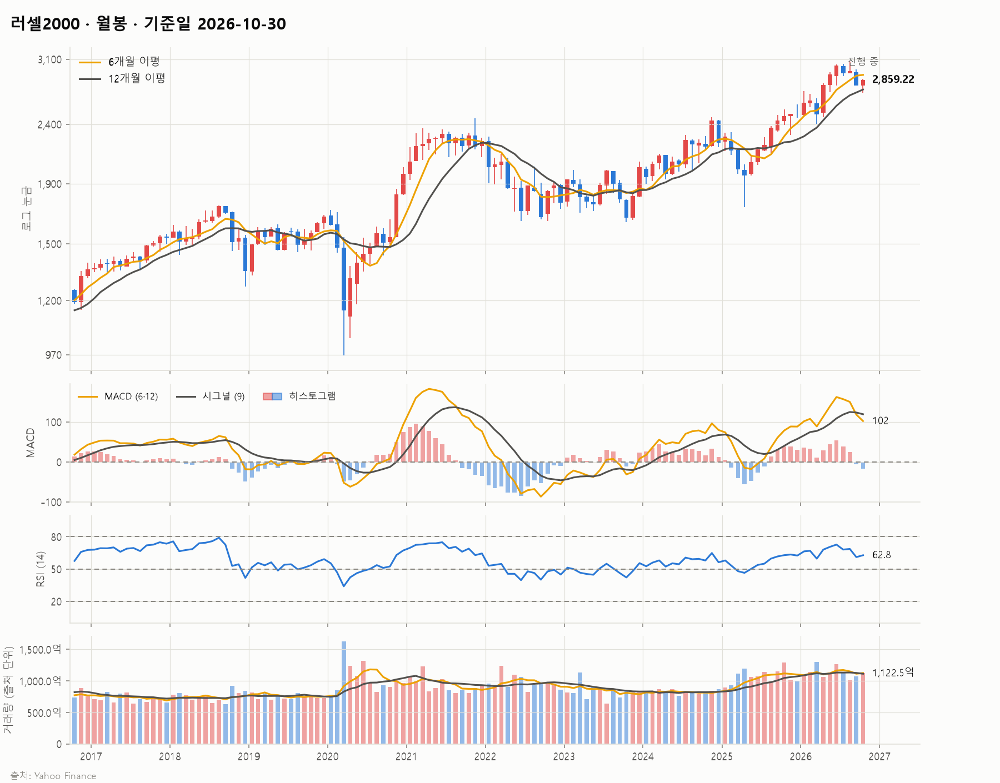
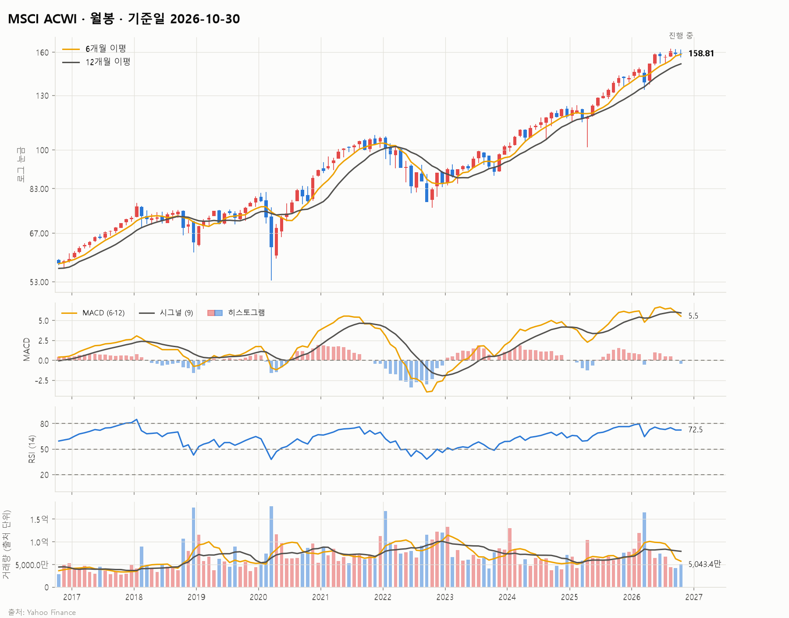
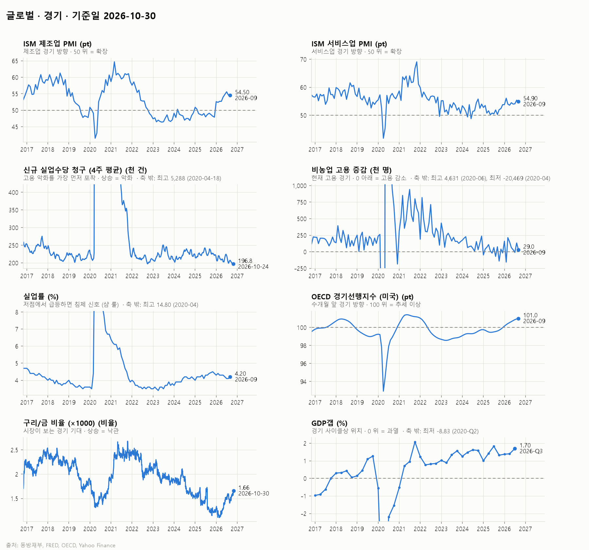
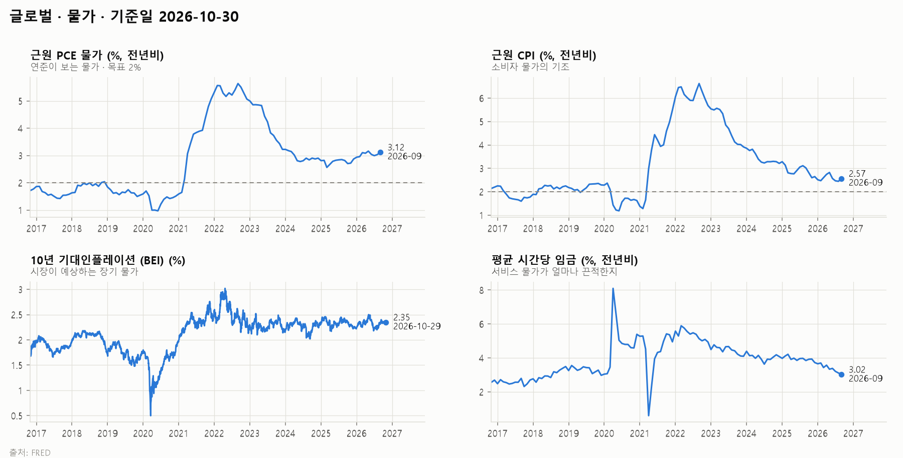
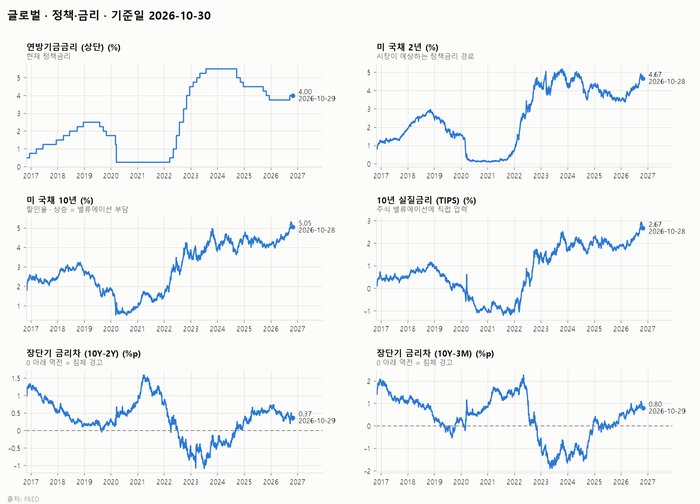
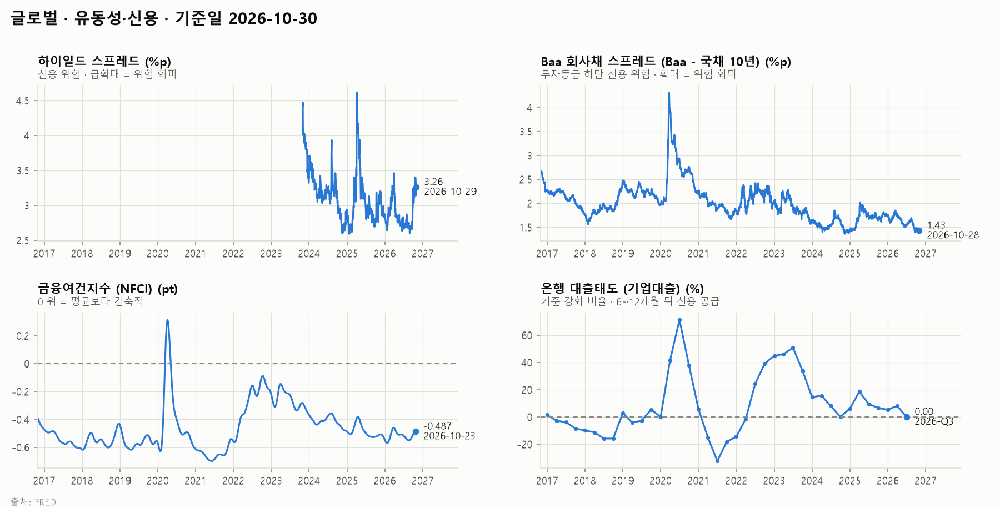
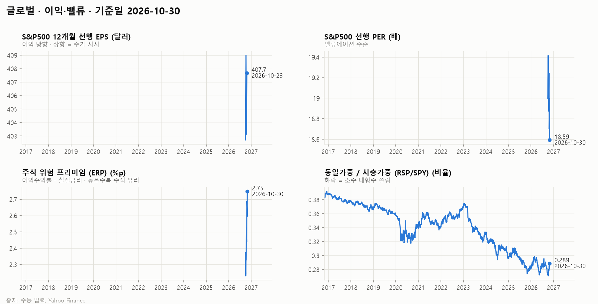
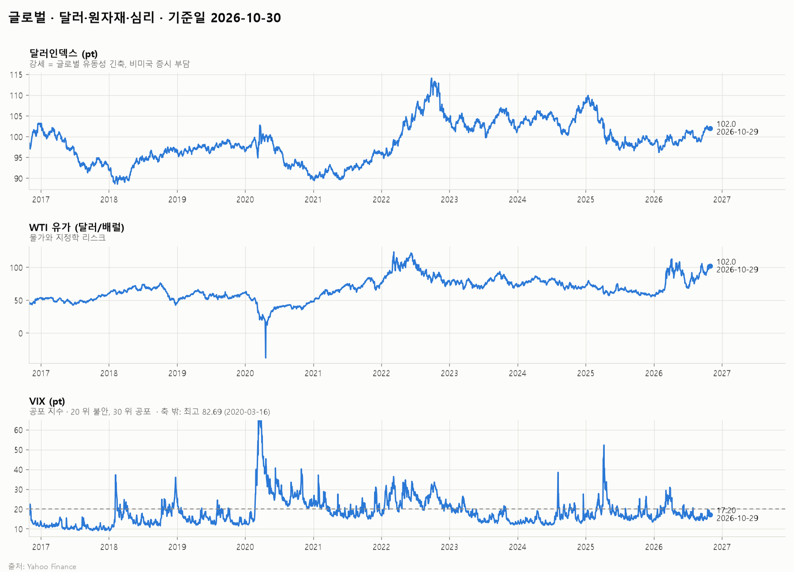

# 글로벌 시장 보고서 (미국 중심) (10년) · 2026-10

## 1. 시장 요약

<!-- summary:start -->
> S&P500은 7,720.39(10/29)로 52주 고점 부근(−1.6%)을 지켰지만, 미 10년물 금리 5%와 연준의 추가 인상 가능성이 상단을 누르고 있다.
<!-- summary:end -->

### 지수 현황

기준: 발행 시점(2026-10-30 23:59 KST)에 확정된 각 지수의 직전 종가

| 지수 | 종가 | 종가일 | 1주 | 1개월 | 3개월 | 연초 대비 | 1년 | 52주 고점 대비 |
|---|---|---|---|---|---|---|---|---|
| S&P500 | 7,720.39 | 2026-10-29 | +0.7% | +0.6% | +5.5% | +12.8% | +12.0% | -1.6% |
| 나스닥 종합 | 26,184.72 | 2026-10-29 | +0.7% | -2.3% | +7.1% | +12.7% | +9.3% | -5.5% |
| 러셀2000 | 2,859.22 | 2026-10-29 | +2.7% | +1.8% | -1.6% | +15.2% | +15.1% | -6.9% |
| MSCI ACWI | 158.81 | 2026-10-29 | +0.9% | -0.4% | +4.2% | +12.2% | +11.4% | -2.5% |

### 주요 요인

<!-- factors:start -->
1. **[정책·금리] 연준 동결, 인상 소수의견 2명** — 10월 28일 FOMC는 기준금리를 3.75~4.00%로 동결했다. 표결은 10대 2였고 쿡 이사와 해맥 클리블랜드 연은 총재가 0.25%p 인상을 주장했다. 9월 16일 0.25%p 인상 이후 첫 동결이며, 성명은 "인플레이션이 여전히 높다"고 적었다 ([Blockchain.News](https://blockchain.news/news/fed-holds-rates-at-375-400-in-split-october-fomc-vote)). 해석: 인하가 아니라 추가 인상 여부가 쟁점인 국면이라, 금리 하락에 기댄 밸류에이션 확장을 기대하기 어렵다.
2. **[정책·금리] 장기금리 5% 돌파** — 미 10년물 금리는 5.05%(10/28)로 3개월 전 4.61%에서 올랐고, 10년 실질금리는 2.67%로 1년 전 1.71%보다 1%p 가까이 높다 (FRED, 2.3절). 해석: 할인율 부담이 성장주에 더 크게 작용해 최근 1개월 나스닥(−2.3%)이 S&P500(+0.6%)보다 부진했다.
3. **[이익·밸류] 알파벳 실적 부진과 AI 투자 회수 우려** — 알파벳은 3분기 매출과 이익이 예상을 밑돌고 잉여현금흐름이 −90억7천만 달러를 기록해 10월 29일 주가가 약 12% 떨어졌고, 나스닥은 1.38% 하락했다 ([10bmnews](https://10bmnews.com/asian-markets-today-nikkei-tumbles-2-ahead-of-bank-of-japan-rate-decision-kospi-crashes-4/)). 해석: AI 설비투자의 수익성 의문이 다시 커지면서 지수를 끌어온 대형 기술주의 이익 기대가 흔들리고 있다.
4. **[달러·원자재·심리] 유가 100달러대** — WTI는 배럴당 103.4달러(10/29)로 3개월 전 84.5달러, 1년 전 60.5달러에서 크게 올랐다 (Yahoo Finance, 2.6절). 해석: 에너지발 물가 압력이 연준의 매파적 태도를 뒷받침한다. 다만 VIX는 17.2로 낮아 시장 불안은 아직 크지 않다.
<!-- factors:end -->

## 2. 지표 (최근 10년)

### 2.1 경기

| 지표 | 최신값 | 기준 시점 | 3개월 전 | 1년 전 |
|---|---|---|---|---|
| ISM 제조업 PMI (pt) | 54.50 | 2026-09 | 54.00 | 49.10 |
| ISM 서비스업 PMI (pt) | 54.90 | 2026-09 | 54.00 | 50.30 |
| 신규 실업수당 청구 (4주 평균) (천 건) | 196.8 | 2026-10-24 | 208.0 | 227.8 |
| 비농업 고용 증감 (천 명) | 29.0 | 2026-09 | 31.0 | 76.0 |
| 실업률 (%) | 4.20 | 2026-09 | 4.20 | 4.40 |
| OECD 경기선행지수 (미국) (pt) | 101.0 | 2026-09 | 100.8 | 99.61 |
| 구리/금 비율 (×1000) (비율) | 1.63 | 2026-10-29 | 1.55 | 1.31 |
| GDP갭 (%) | 1.70 | 2026-Q3 | 1.40 | 1.83 |

데이터 메모:

- 신규 실업수당 청구 (4주 평균): 극단값을 축 밖으로 잘라 그림 (최고 5,288 (2020-04-18))
- 비농업 고용 증감: 극단값을 축 밖으로 잘라 그림 (최고 4,631 (2020-06), 최저 -20,469 (2020-04))
- 실업률: 극단값을 축 밖으로 잘라 그림 (최고 14.80 (2020-04))
- GDP갭: 극단값을 축 밖으로 잘라 그림 (최저 -8.83 (2020-Q2))

### 2.2 물가

| 지표 | 최신값 | 기준 시점 | 3개월 전 | 1년 전 |
|---|---|---|---|---|
| 근원 PCE 물가 (%, 전년비) | 3.12 | 2026-09 | 3.04 | 2.82 |
| 근원 CPI (%, 전년비) | 2.57 | 2026-09 | 2.57 | 3.02 |
| 10년 기대인플레이션 (BEI) (%) | 2.35 | 2026-10-29 | 2.26 | 2.30 |
| 평균 시간당 임금 (%, 전년비) | 3.02 | 2026-09 | 3.38 | 3.85 |

### 2.3 정책·금리

| 지표 | 최신값 | 기준 시점 | 3개월 전 | 1년 전 |
|---|---|---|---|---|
| 연방기금금리 (상단) (%) | 4.00 | 2026-10-29 | 3.75 | 4.25 |
| 미 국채 2년 (%) | 4.67 | 2026-10-28 | 4.26 | 3.47 |
| 미 국채 10년 (%) | 5.05 | 2026-10-28 | 4.61 | 3.99 |
| 10년 실질금리 (TIPS) (%) | 2.67 | 2026-10-28 | 2.41 | 1.71 |
| 장단기 금리차 (10Y−2Y) (%p) | 0.37 | 2026-10-29 | 0.45 | 0.49 |
| 장단기 금리차 (10Y−3M) (%p) | 0.80 | 2026-10-29 | 0.84 | 0.15 |

### 2.4 유동성·신용

| 지표 | 최신값 | 기준 시점 | 3개월 전 | 1년 전 |
|---|---|---|---|---|
| 하이일드 스프레드 (%p) | 3.26 | 2026-10-29 | 2.87 | 2.76 |
| Baa 회사채 스프레드 (Baa − 국채 10년) (%p) | 1.43 | 2026-10-28 | 1.62 | 1.65 |
| 금융여건지수 (NFCI) (pt) | -0.487 | 2026-10-23 | -0.531 | -0.520 |
| 은행 대출태도 (기업대출) (%) | 0.00 | 2026-Q3 | 8.10 | 9.50 |

데이터 메모:

- 하이일드 스프레드: 이력이 2023-10-31부터만 있음

### 2.5 이익·밸류

| 지표 | 최신값 | 기준 시점 | 3개월 전 | 1년 전 |
|---|---|---|---|---|
| S&P500 12개월 선행 EPS (달러) | 407.7 | 2026-10-23 | — | — |
| S&P500 선행 PER (배) | 18.94 | 2026-10-29 | — | — |
| 주식 위험 프리미엄 (ERP) (%p) | 2.61 | 2026-10-29 | — | — |
| 동일가중 / 시총가중 (RSP/SPY) (비율) | 0.286 | 2026-10-29 | 0.296 | 0.274 |

데이터 메모:

- S&P500 12개월 선행 EPS: 수동 입력 값 4개뿐 (2026-09-30부터)
- S&P500 선행 PER: 이력이 2026-09-30부터만 있음
- 주식 위험 프리미엄 (ERP): 이력이 2026-09-30부터만 있음

### 2.6 달러·원자재·심리

| 지표 | 최신값 | 기준 시점 | 3개월 전 | 1년 전 |
|---|---|---|---|---|
| 달러인덱스 (pt) | 102.0 | 2026-10-29 | 100.8 | 99.22 |
| WTI 유가 (달러/배럴) | 102.0 | 2026-10-29 | 84.46 | 60.48 |
| VIX (pt) | 17.20 | 2026-10-29 | 20.66 | 16.92 |

데이터 메모:

- VIX: 극단값을 축 밖으로 잘라 그림 (최고 82.69 (2020-03-16))

## 정정

- 2026-10-31: 지수 캔들 차트의 가격 축을 로그 눈금으로 바꿨다. 수치는 바뀌지 않았다.
- 2026-10-31: 지수 월봉 차트의 이동평균을 5·20개월에서 6개월(반년)·12개월(1년)로 바꿨다. 수치는 바뀌지 않았다.
- 2026-10-31: 지수 월봉 차트의 가격과 거래량 사이에 MACD(6·12·9)와 RSI(14) 패널을 추가했다. 수치는 바뀌지 않았다.
