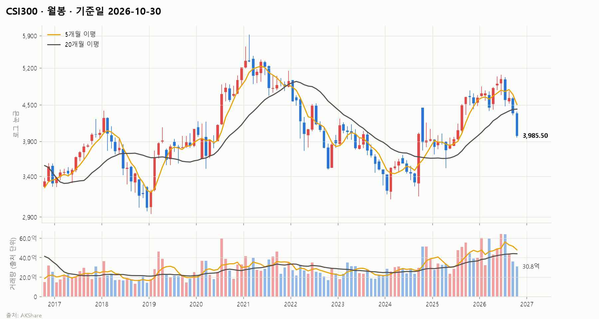
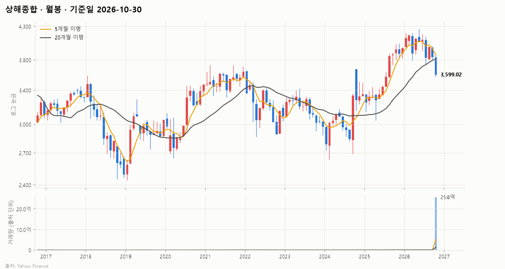
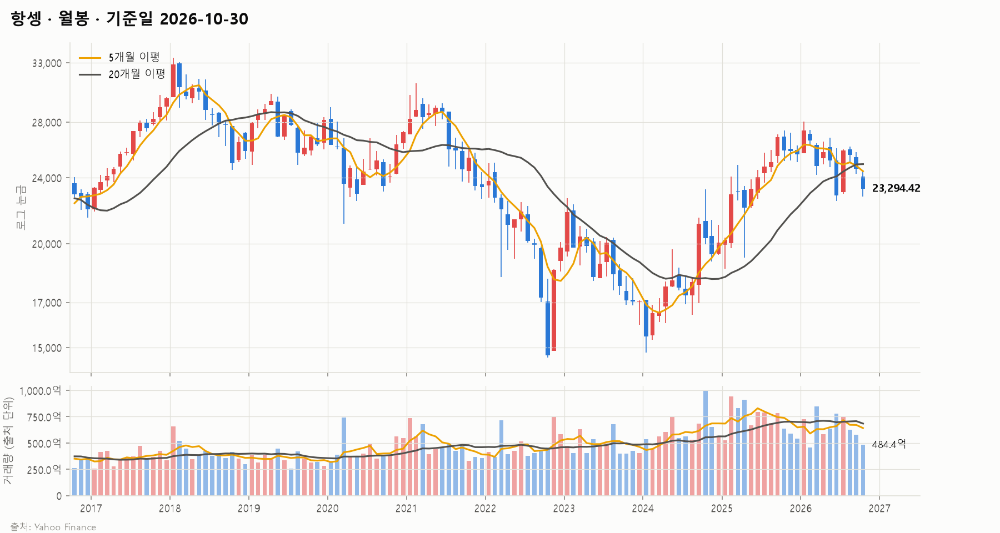
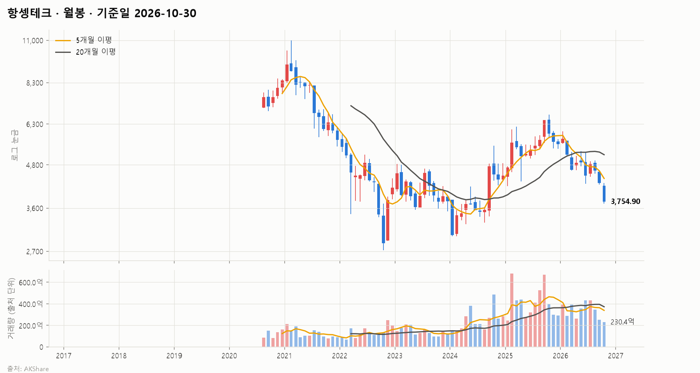
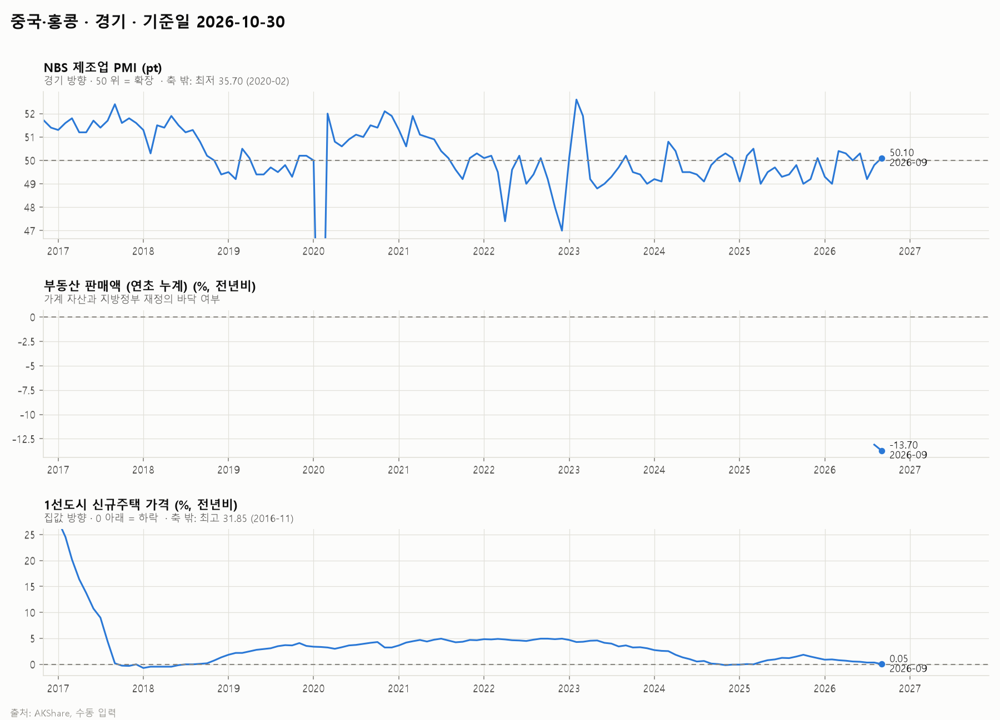
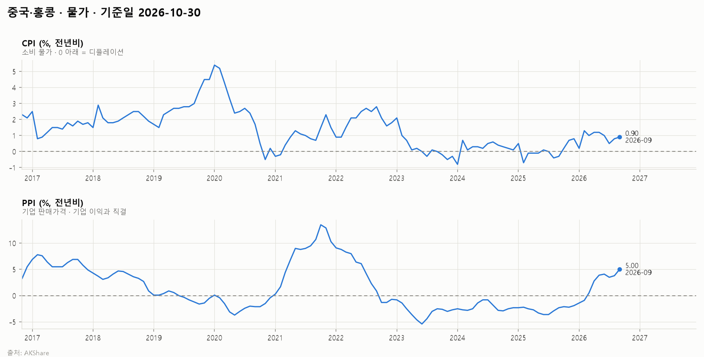
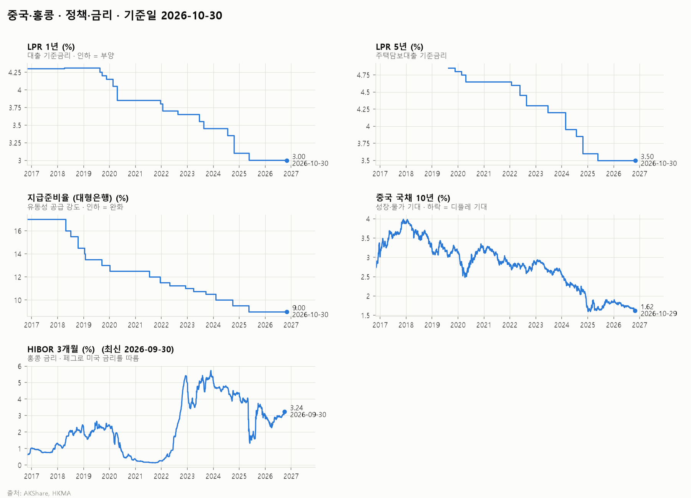
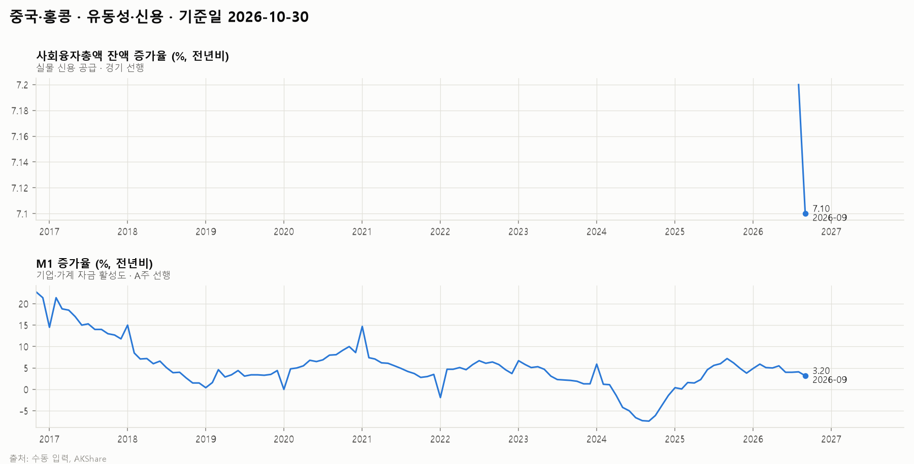
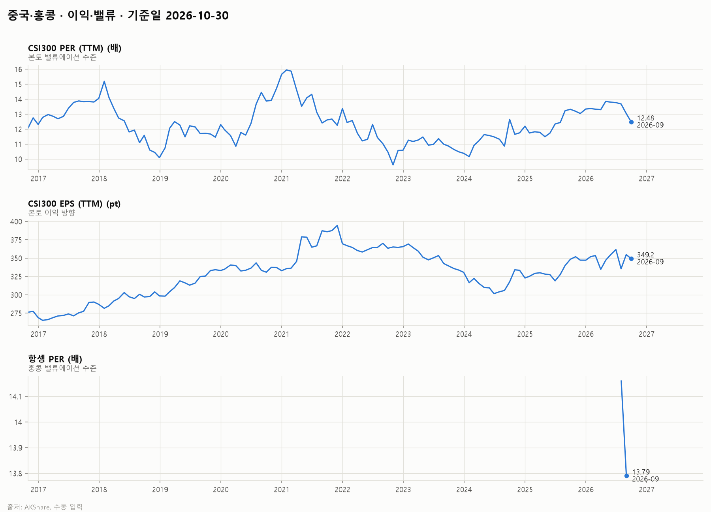
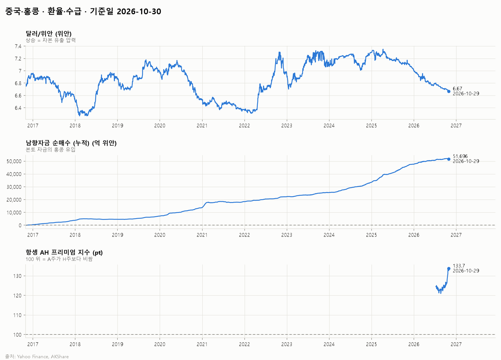

# 중국·홍콩 시장 보고서 (10년) · 2026-10

## 1. 시장 요약

<!-- summary:start -->
> CSI300은 부양 기대 후퇴와 이익 둔화 속에 10월 한 달 8.5% 하락해 3,985.50(10/30)에 마감했고, 52주 고점 대비 −21.3%로 약세장에 머물렀다.
<!-- summary:end -->

### 지수 현황

기준: 발행 시점(2026-10-30 23:59 KST)에 확정된 각 지수의 직전 종가

| 지수 | 종가 | 종가일 | 1주 | 1개월 | 3개월 | 연초 대비 | 1년 | 52주 고점 대비 |
|---|---|---|---|---|---|---|---|---|
| CSI300 | 3,985.50 | 2026-10-30 | -2.9% | -8.5% | -12.4% | -13.9% | -15.4% | -21.3% |
| 상해종합 | 3,599.02 | 2026-10-30 | -2.5% | -6.3% | -5.4% | -9.3% | -9.7% | -15.5% |
| 항셍 | 23,294.42 | 2026-10-30 | +0.9% | -5.4% | -9.9% | -9.1% | -11.4% | -17.0% |
| 항셍테크 | 3,754.90 | 2026-10-30 | -3.0% | -11.7% | -21.8% | -31.9% | -38.0% | -37.7% |

### 주요 요인

<!-- factors:start -->
1. **[이익·밸류] 이익 둔화 속 기록적 연속 하락** — CSI300은 10월 22일 4,036.30에 마감해 6월 고점 대비 약 20% 하락하며 약세장에 진입했고, 주간 기준 10주 연속 하락으로 사상 최장 기록을 세웠다 ([Khan Capital](https://khancapitals.com/csi-300-bear-market/)). CSI300의 최근 12개월 EPS는 9월 말 349.2로 3개월 전 361.6보다 3.4% 줄었다 (AKShare, 2.5절). 해석: 상반기 AI 랠리가 되돌려지는 가운데 이익도 줄어 밸류에이션 하락과 이익 감소가 겹쳤다.
2. **[경기] 성장률 호조가 오히려 부양 기대를 낮춤** — 3분기 GDP는 전년비 4.5%로 예상(4.4%)을 웃돌았지만 9월 소매판매는 1.1% 증가에 그쳤다 ([Khan Capital](https://khancapitals.com/csi-300-bear-market/)). 9월 PPI는 전년비 +5.0%로 1년 전 −2.3%에서 크게 올랐다 (AKShare, 2.2절). 해석: 성장률 목표 달성과 생산자물가 상승으로 대규모 부양이나 공격적 완화 기대가 줄었고, 가계 수요는 여전히 약하다.
3. **[기타] 희토류 수출통제 유예 종료 임박** — 2025년 11월 7일 발표된 희토류 수출통제 확대 조치의 1년 유예가 2026년 11월 10일 끝나며, 연장 소식은 없다 ([Pomegra](https://pomegra.io/briefs/2026-10-26-csi-300-11th-weekly-decline)). 해석: 미중 갈등 재점화 가능성이 위험 회피를 키우는 요인이다.
4. **[환율·수급] 홍콩 기술주 낙폭 확대** — 항셍테크는 최근 1개월 −11.7%, 3개월 −21.8%로 항셍(−5.4%, −9.9%)보다 크게 떨어졌다. AH 프리미엄 지수는 133.7(10/29)로 3개월 전 122.5에서 올라 H주가 A주보다 더 약했다 (AKShare, 지수 현황 표·2.6절). 다만 10월 30일에는 항셍이 1.46% 올라 23,294.42에 마감하며 CSI300(−1.4%)과 엇갈렸다 ([Bastille Post](https://www.bastillepost.com/global/article/6308429-hong-kong-stocks-close-higher-22), 종가는 Yahoo Finance와 대조). 해석: AI·기술주 조정이 해외 자금 비중이 큰 홍콩에 더 크게 반영돼 왔다.
<!-- factors:end -->

## 2. 지표 (최근 10년)

### 2.1 경기

| 지표 | 최신값 | 기준 시점 | 3개월 전 | 1년 전 |
|---|---|---|---|---|
| NBS 제조업 PMI (pt) | 50.10 | 2026-09 | 50.30 | 49.80 |
| 부동산 판매액 (연초 누계) (%, 전년비) | -13.70 | 2026-09 | — | — |
| 1선도시 신규주택 가격 (%, 전년비) | 0.05 | 2026-09 | 0.50 | 1.50 |

데이터 메모:

- NBS 제조업 PMI: 극단값을 축 밖으로 잘라 그림 (최저 35.70 (2020-02))
- 부동산 판매액 (연초 누계): 수동 입력 값 2개뿐 (2026-08부터)
- 1선도시 신규주택 가격: 극단값을 축 밖으로 잘라 그림 (최고 31.85 (2016-11))

### 2.2 물가

| 지표 | 최신값 | 기준 시점 | 3개월 전 | 1년 전 |
|---|---|---|---|---|
| CPI (%, 전년비) | 0.90 | 2026-09 | 1.00 | -0.30 |
| PPI (%, 전년비) | 5.00 | 2026-09 | 4.10 | -2.30 |

### 2.3 정책·금리

| 지표 | 최신값 | 기준 시점 | 3개월 전 | 1년 전 |
|---|---|---|---|---|
| LPR 1년 (%) | 3.00 | 2026-10-30 | 3.00 | 3.00 |
| LPR 5년 (%) | 3.50 | 2026-10-30 | 3.50 | 3.50 |
| 지급준비율 (대형은행) (%) | 9.00 | 2026-10-30 | 9.00 | 9.00 |
| 중국 국채 10년 (%) | 1.62 | 2026-10-29 | 1.73 | 1.82 |
| HIBOR 3개월 (%) | 3.24 | 2026-09-30 | 2.97 | 3.53 |

데이터 메모:

- LPR 5년: 이력이 2019-08-20부터만 있음
- HIBOR 3개월: 최신 데이터가 2026-09-30로 지연

### 2.4 유동성·신용

| 지표 | 최신값 | 기준 시점 | 3개월 전 | 1년 전 |
|---|---|---|---|---|
| 사회융자총액 잔액 증가율 (%, 전년비) | 7.10 | 2026-09 | — | — |
| M1 증가율 (%, 전년비) | 3.20 | 2026-09 | 4.00 | 7.20 |

데이터 메모:

- 사회융자총액 잔액 증가율: 수동 입력 값 2개뿐 (2026-08부터)

### 2.5 이익·밸류

| 지표 | 최신값 | 기준 시점 | 3개월 전 | 1년 전 |
|---|---|---|---|---|
| CSI300 PER (TTM) (배) | 12.48 | 2026-09 | 13.77 | 13.32 |
| CSI300 EPS (TTM) (pt) | 349.2 | 2026-09 | 361.6 | 348.4 |
| 항셍 PER (배) | 13.79 | 2026-09 | — | — |

데이터 메모:

- 항셍 PER: 수동 입력 값 2개뿐 (2026-08부터)

### 2.6 환율·수급

| 지표 | 최신값 | 기준 시점 | 3개월 전 | 1년 전 |
|---|---|---|---|---|
| 달러/위안 (위안) | 6.67 | 2026-10-29 | 6.77 | 7.10 |
| 남향자금 순매수 (누적) (억 위안) | 51,696 | 2026-10-29 | 51,318 | 45,917 |
| 항셍 AH 프리미엄 지수 (pt) | 133.7 | 2026-10-29 | 122.5 | — |

데이터 메모:

- 항셍 AH 프리미엄 지수: 이력이 2026-07-10부터만 있음

## 정정

- 2026-10-31: 지수 캔들 차트의 가격 축을 로그 눈금으로 바꿨다. 수치는 바뀌지 않았다.
