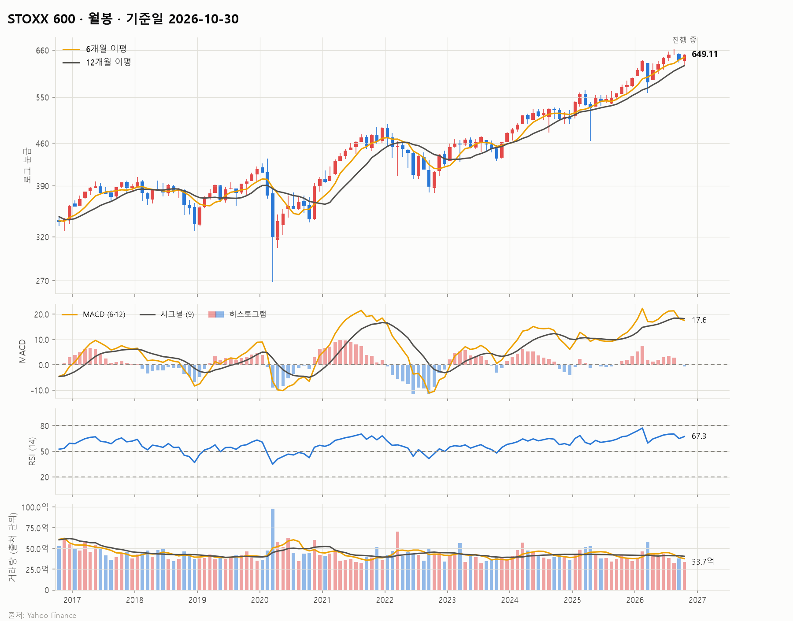
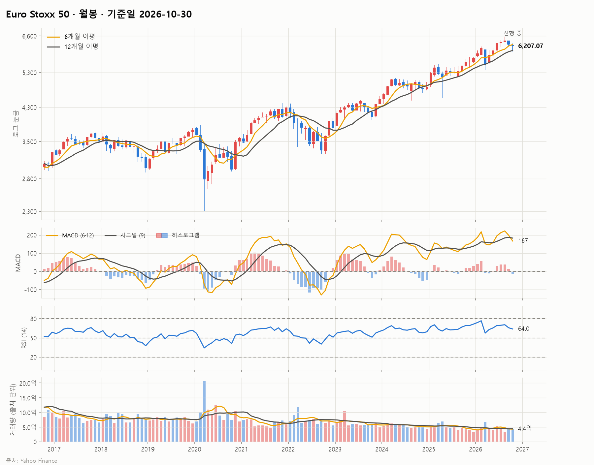
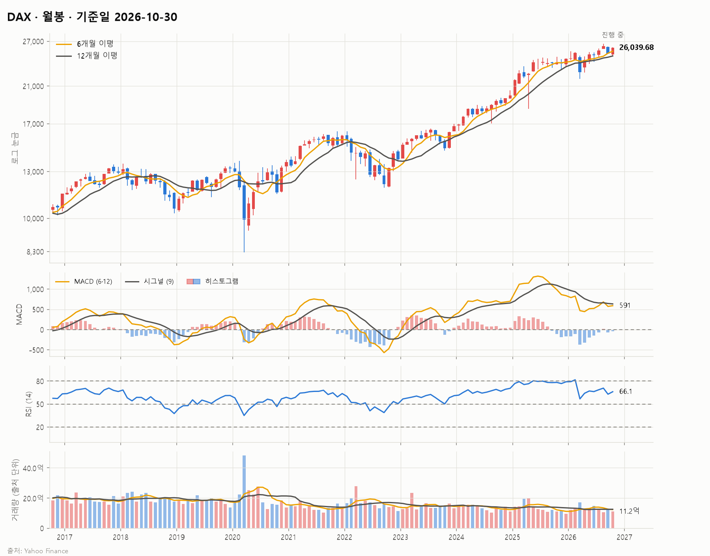
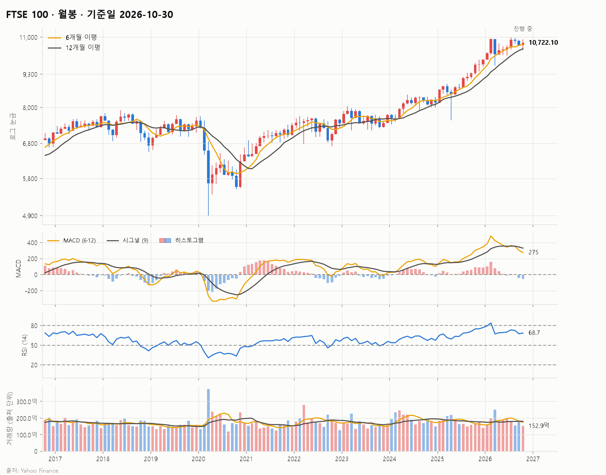
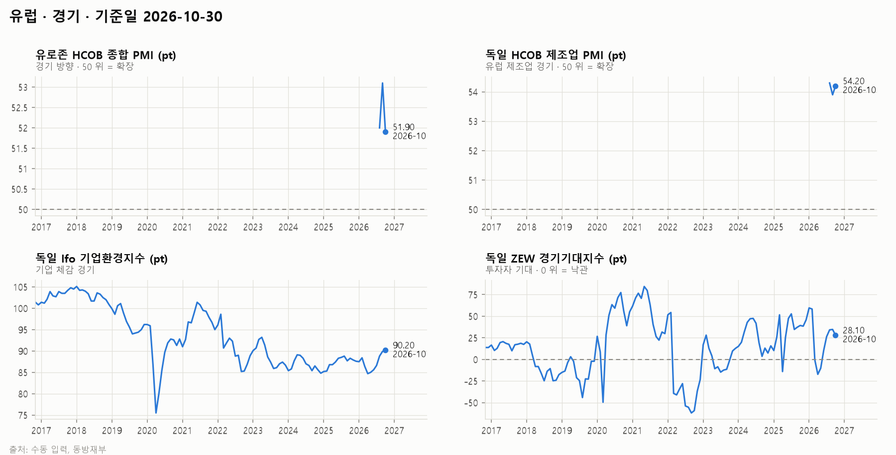
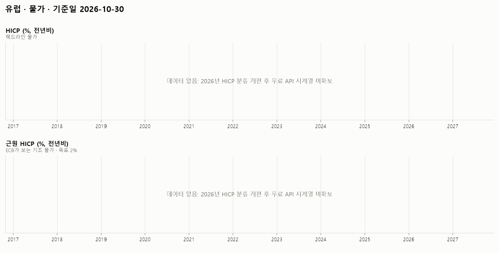
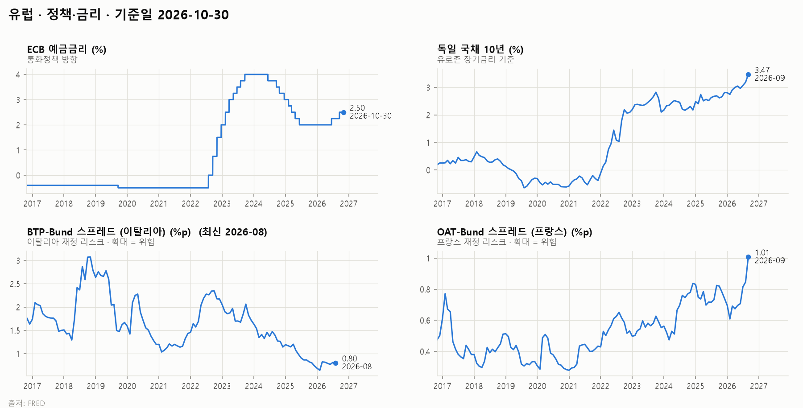
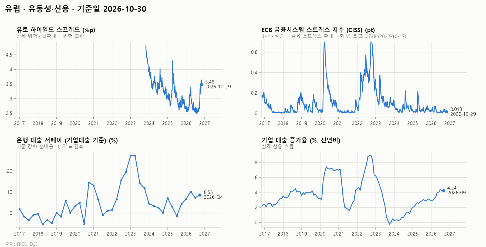
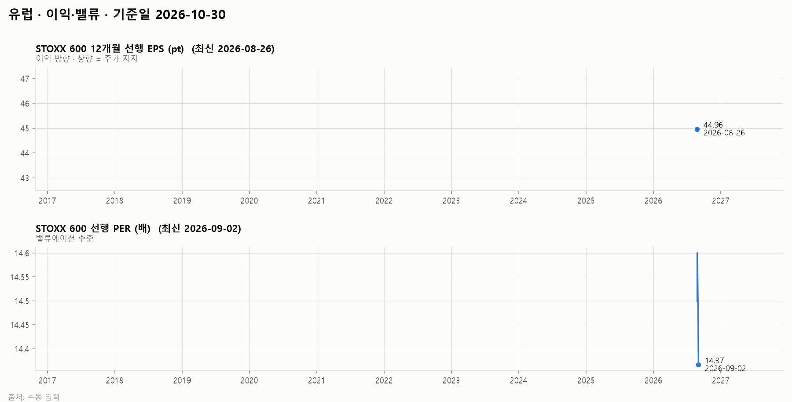
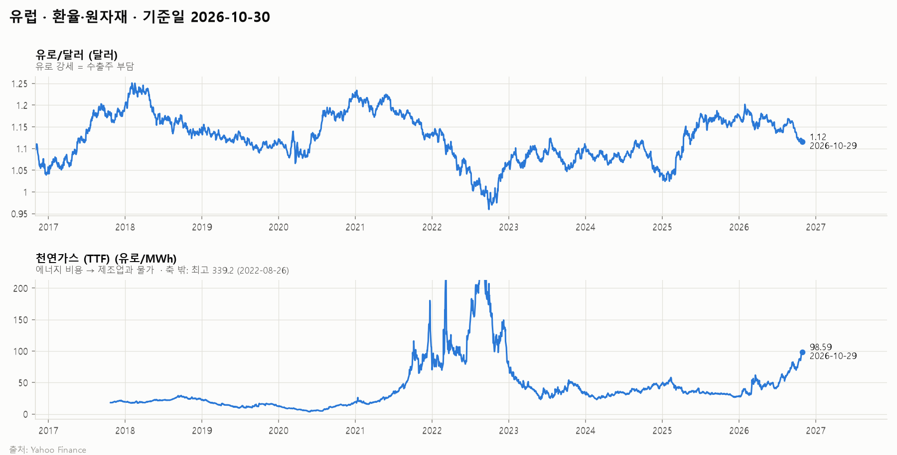

# 유럽 시장 보고서 (10년) · 2026-10

## 1. 시장 요약

<!-- summary:start -->
> STOXX 600은 ECB 동결과 에너지·소비재 실적에 힘입어 649.11(10/29)로 9월 초 이후 최고 수준에 올랐지만, 프랑스 국채 금리 급등과 에너지 가격이 위험 요인으로 남았다.
<!-- summary:end -->

### 지수 현황

기준: 발행 시점(2026-10-30 23:59 KST)에 확정된 각 지수의 직전 종가

| 지수 | 종가 | 종가일 | 1주 | 1개월 | 3개월 | 연초 대비 | 1년 | 52주 고점 대비 |
|---|---|---|---|---|---|---|---|---|
| STOXX 600 | 649.11 | 2026-10-29 | +1.8% | +1.7% | +0.6% | +9.5% | +12.8% | -2.2% |
| Euro Stoxx 50 | 6,207.07 | 2026-10-29 | +2.0% | -1.8% | -0.7% | +7.1% | +8.8% | -5.6% |
| DAX | 26,039.68 | 2026-10-29 | +2.6% | +2.5% | +2.3% | +6.3% | +7.9% | -2.2% |
| FTSE 100 | 10,722.10 | 2026-10-29 | -0.0% | +0.8% | -1.7% | +8.0% | +9.9% | -2.4% |

### 주요 요인

<!-- factors:start -->
1. **[정책·금리] ECB 동결** — ECB는 10월 29일 예금금리를 2.50%로 동결했다. 6월과 9월 인상 이후 '전술적 휴지'이며, 직전 회의 이후 금융 여건이 긴축됐고 에너지 가격이 계속 오른다고 언급했다. 당일 STOXX 600은 0.8% 올라 9월 8일 이후 최고였다 ([Yahoo Finance](https://finance.yahoo.com/markets/world-indices/articles/european-shares-inch-ahead-ecb-084025144.html)). 해석: 추가 인상을 서두르지 않는다는 신호로 받아들여져 주가에 안도감을 줬다.
2. **[정책·금리] 프랑스 국채 금리 급등** — 프랑스 10년물 금리는 10월 21일 2002년 7월 이후 처음 5%를 넘었고, OAT−Bund 스프레드는 10월 23일 176bp로 2011년 이후 최대였다가 29일 약 155bp로 좁혀졌다. 과반 없는 정부의 2027년 예산안 표결(11/3)과 GDP 대비 약 5.4%의 재정적자가 배경이다 ([Admirals](https://admiralmarkets.com/analytics/traders-blog/oat-bund-spread-france-euro)). 해석: 유로존 재정 리스크가 다시 커지면 은행주와 유로화에 부담이 된다. 11월 3일 표결이 단기 고비다.
3. **[이익·밸류] 3분기 실적 엇갈림** — 셸은 분기 순이익이 예상을 넘어 2.6% 올랐고 아디다스는 연간 전망 상향으로 2.5% 올랐다. 폭스바겐은 9개월 영업이익이 98.7% 줄어 1.6% 떨어졌다 ([Yahoo Finance](https://finance.yahoo.com/markets/world-indices/articles/european-shares-inch-ahead-ecb-084025144.html)). 해석: 에너지와 일부 소비재는 버티지만 자동차 등 제조업 이익은 크게 훼손됐다.
4. **[환율·원자재] 에너지 가격 상승** — 유럽 천연가스(TTF)는 MWh당 97.5유로(10/29)로 3개월 전 60.4유로, 1년 전 31.9유로에서 크게 올랐다 (Yahoo Finance, 2.6절). 해석: 제조업 비용과 물가를 함께 압박해 ECB 정책과 경기 모두에 부담이다.
<!-- factors:end -->

## 2. 지표 (최근 10년)

### 2.1 경기

| 지표 | 최신값 | 기준 시점 | 3개월 전 | 1년 전 |
|---|---|---|---|---|
| 유로존 HCOB 종합 PMI (pt) | 51.90 | 2026-10 | — | — |
| 독일 HCOB 제조업 PMI (pt) | 54.20 | 2026-10 | — | — |
| 독일 Ifo 기업환경지수 (pt) | 90.20 | 2026-10 | 86.60 | 88.30 |
| 독일 ZEW 경기기대지수 (pt) | 28.10 | 2026-10 | 26.30 | 39.30 |

데이터 메모:

- 유로존 HCOB 종합 PMI: 수동 입력 값 3개뿐 (2026-08부터)
- 독일 HCOB 제조업 PMI: 수동 입력 값 3개뿐 (2026-08부터)

### 2.2 물가

| 지표 | 최신값 | 기준 시점 | 3개월 전 | 1년 전 |
|---|---|---|---|---|
| HICP (%, 전년비) | — | — | — | — |
| 근원 HICP (%, 전년비) | — | — | — | — |

데이터 메모:

- HICP: 데이터 없음 (2026년 HICP 분류 개편 후 무료 API 시계열 미확보)
- 근원 HICP: 데이터 없음 (2026년 HICP 분류 개편 후 무료 API 시계열 미확보)

### 2.3 정책·금리

| 지표 | 최신값 | 기준 시점 | 3개월 전 | 1년 전 |
|---|---|---|---|---|
| ECB 예금금리 (%) | 2.50 | 2026-10-29 | 2.25 | 2.00 |
| 독일 국채 10년 (%) | 3.47 | 2026-09 | 2.96 | 2.69 |
| BTP−Bund 스프레드 (이탈리아) (%p) | 0.80 | 2026-08 | 0.79 | 0.86 |
| OAT−Bund 스프레드 (프랑스) (%p) | 1.01 | 2026-09 | 0.71 | 0.82 |

데이터 메모:

- BTP−Bund 스프레드 (이탈리아): 최신 데이터가 2026-08로 지연

### 2.4 유동성·신용

| 지표 | 최신값 | 기준 시점 | 3개월 전 | 1년 전 |
|---|---|---|---|---|
| 유로 하이일드 스프레드 (%p) | 3.48 | 2026-10-29 | 2.64 | 2.78 |
| ECB 금융시스템 스트레스 지수 (CISS) (pt) | 0.013 | 2026-10-29 | 0.010 | 0.037 |
| 은행 대출 서베이 (기업대출 기준) (%) | 8.55 | 2026-Q4 | 7.29 | 4.18 |
| 기업 대출 증가율 (%, 전년비) | 4.24 | 2026-09 | 4.02 | 2.90 |

데이터 메모:

- 유로 하이일드 스프레드: 이력이 2023-10-31부터만 있음
- ECB 금융시스템 스트레스 지수 (CISS): 극단값을 축 밖으로 잘라 그림 (최고 0.738 (2022-10-17))

### 2.5 이익·밸류

| 지표 | 최신값 | 기준 시점 | 3개월 전 | 1년 전 |
|---|---|---|---|---|
| STOXX 600 12개월 선행 EPS (pt) | 44.96 | 2026-08-26 | — | — |
| STOXX 600 선행 PER (배) | 14.37 | 2026-09-02 | — | — |

데이터 메모:

- STOXX 600 12개월 선행 EPS: 수동 입력 값 1개뿐 (2026-08-26부터)
- STOXX 600 12개월 선행 EPS: 최신 데이터가 2026-08-26로 지연
- STOXX 600 선행 PER: 이력이 2026-08-26부터만 있음
- STOXX 600 선행 PER: 최신 데이터가 2026-09-02로 지연

### 2.6 환율·원자재

| 지표 | 최신값 | 기준 시점 | 3개월 전 | 1년 전 |
|---|---|---|---|---|
| 유로/달러 (달러) | 1.12 | 2026-10-29 | 1.14 | 1.17 |
| 천연가스 (TTF) (유로/MWh) | 98.59 | 2026-10-29 | 60.42 | 31.87 |

데이터 메모:

- 천연가스 (TTF): 이력이 2017-10-23부터만 있음
- 천연가스 (TTF): 극단값을 축 밖으로 잘라 그림 (최고 339.2 (2022-08-26))

## 정정

- 2026-10-31: 지수 캔들 차트의 가격 축을 로그 눈금으로 바꿨다. 수치는 바뀌지 않았다.
- 2026-10-31: 지수 월봉 차트의 이동평균을 5·20개월에서 6개월(반년)·12개월(1년)로 바꿨다. 수치는 바뀌지 않았다.
- 2026-10-31: 지수 월봉 차트의 가격과 거래량 사이에 MACD(6·12·9)와 RSI(14) 패널을 추가했다. 수치는 바뀌지 않았다.
